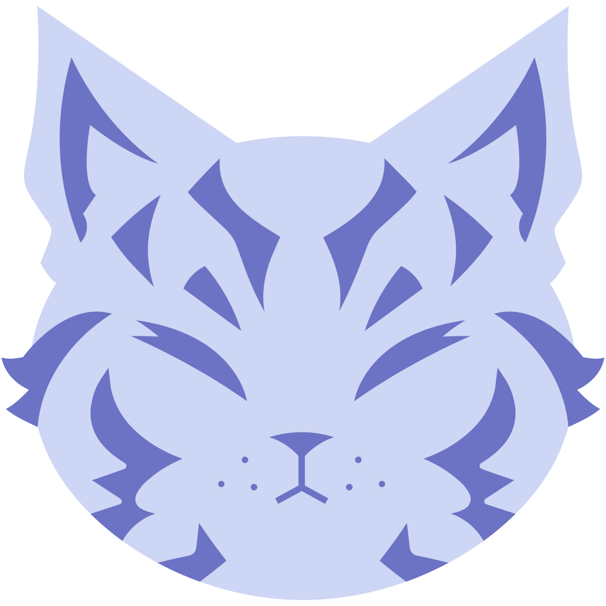

<div align="center">



# Neosaider

**Headless, local-first harness for Neo, your personal assistant.**

> [!WARNING]
> The project is in the experimental phase.

Bring your own models. One SQLite file. Modules run as Docker containers.

[](LICENSE.md)
[](https://nodejs.org)
[](https://www.docker.com)
[](CONTRIBUTING.md)

[Getting started](#getting-started) · [Modules](#modules) · [Architecture](docs/ARCHITECTURE.md) · [Security](SECURITY.md) · [Contributing](CONTRIBUTING.md)

</div>

## Summary

Neosaider hosts Neo, an agent built with LangGraph JS, behind an HTTP API with SSE streaming. It is designed for one user and one machine:

- **Local models.** Neo talks to any OpenAI-compatible server (Ollama, llama.cpp, Jan, LM Studio, vLLM). No paid services are required.
- **One data file.** Conversations, long-term memories, scheduled tasks, notifications and modules live in a single SQLite file (`better-sqlite3` + `sqlite-vec`).
- **Long-term memory.** After each run Neo extracts durable facts about you, and it recalls the relevant ones before answering.
- **Proactive.** Cron, one-off and `session.start` triggers run Neo in the background and deliver the answer to every client, even ones that were offline.
- **Extensible with modules.** Domain tools come from MCP servers. They are installed from a catalog as hardened Docker containers, each with its own volume, and removed completely on uninstall.
- **Any frontend.** It ships a terminal CLI and a local Next.js web UI, and it speaks the [Agent Streaming Protocol](https://github.com/langchain-ai/agent-protocol/tree/main/streaming) v2, so `useStream` frontends work out of the box.

## How it works



1. A client (the CLI, the web UI or any `useStream` app) sends a message to the **harness** (`apps/harness`), authenticated with a bearer token.
2. The harness runs **Neo** (`packages/core`), a LangGraph `StateGraph` with the shape `recall → agent ⇄ tools`:
   1. Neo recalls relevant memories.
   2. It calls the model with the system prompt, which describes its modules, tasks and memory state.
   3. It runs any tool calls, whether built-in (memory, scheduling) or provided by MCP modules.
3. Tokens, tool calls and tool results stream back over SSE. Each step is checkpointed in SQLite, so threads survive restarts.
4. After the run, a fast model extracts memories in the background. A persisted queue retries the extraction if the model server is down.
5. The **scheduler** fires triggers, runs Neo in `proactive:*` threads and stores the answer in a notification inbox. Each client keeps a cursor, so it receives everything it missed.
6. The **module installer** reads a catalog, validates the module manifest, and runs the module as a container through Docker. It then connects to the module over MCP. Its tools are available from the next answer on, without a restart.

# Purpose

The purpose of this project is to create a modular, AI-compatible ecosystem for assistance in any personal environment. This means that the approach is strictly focused on local operation to preserve data privacy. The inspiration for this project stems from the desire to have a fully modular system for a smart home—an AI that has controlled access to the components you provide and has the autonomy to follow and execute the commands you give it, similar to Alexa.

The project is a personal research effort with the vision that small, fast AI models can function as personal assistants that control devices in the home. The specific hardware required has not yet been proposed or tested.

## Getting started

You need **Node.js 24+**, **pnpm 11** and an OpenAI-compatible model server that supports tool calling. Installing modules also needs Docker.

### Local

```sh
cp .env.example .env    # set NEOSAIDER_API_TOKEN, e.g. `openssl rand -hex 32`
pnpm install
pnpm build
pnpm --filter @neosaider/harness dev    # API on http://localhost:3000
pnpm --filter @neosaider/web dev        # UI on http://127.0.0.1:3001
pnpm --filter @neosaider/cli start      # terminal client
```

Set `NEO_LLM_BASE_URL`, `NEO_CHAT_MODEL`, `NEO_FAST_MODEL` and `NEO_EMBED_MODEL` in `.env`. With Ollama:

```sh
ollama pull qwen3:8b && ollama pull qwen3:1.7b && ollama pull nomic-embed-text
```

Leave `NEO_EMBED_MODEL` empty to run without long-term memory. Every variable is described in [Configuration](./apps/harness/docs/CONFIGURATION.md).

### Docker Compose

```sh
cp .env.example .env                       # set NEOSAIDER_API_TOKEN
docker compose --profile modules build     # module images the store can install
docker compose up -d --build
docker compose exec ollama ollama pull qwen3:8b
docker compose exec ollama ollama pull qwen3:1.7b
docker compose exec ollama ollama pull nomic-embed-text
```

The UI is at `http://127.0.0.1:3001`. Compose runs four services:

- `harness`, whose data lives in the `harness-data` volume;
- `web`, the UI;
- `ollama`, whose models live in the `ollama-models` volume;
- `docker-proxy`, which the harness uses to manage module containers.

### Talking to the API

```sh
curl -N -X POST http://localhost:3000/threads/t1/messages \
  -H "Authorization: Bearer $NEOSAIDER_API_TOKEN" -H 'Content-Type: application/json' \
  -d '{"message":"I train every day at 6am"}'
```

The full reference is in [REST API](./apps/harness/docs/API.md) and [Agent Streaming Protocol](./apps/harness/docs/AGENT-PROTOCOL.md).

## Modules

A module is an **MCP server over HTTP**, packaged as a **Docker image** and described by a **manifest** (`neosaider.module.json`). The harness installs it from the [catalog](./docs/CATALOG.md) into its own container and volume. Neo sees its tools prefixed with the module id.

| Module                                       | What it does                                                                               |
| -------------------------------------------- | ------------------------------------------------------------------------------------------ |
| [`gym`](./modules/gym/README.md)             | Workout log: `gym_log_workout` and `gym_list_workouts`, stored in the module's own SQLite. |
| [`_template`](./modules/_template/README.md) | Minimal module to copy when you create a new one. It is not in the catalog.                |

You can install modules from the web UI store or with `POST /modules/install`. You can also register any external MCP server by URL with `POST /modules`.

To build your own module, read [Creating a module](./packages/module-sdk/docs/CREATING-A-MODULE.md), which uses [`@neosaider/module-sdk`](./packages/module-sdk/README.md).

## Architecture

The monorepo uses pnpm and Turborepo. Each package belongs to a layer, and `pnpm turbo boundaries` enforces which layers may import which.



| Project                                                  | Layer             | Role                                                                     |
| -------------------------------------------------------- | ----------------- | ------------------------------------------------------------------------ |
| [`packages/contracts`](./packages/contracts/README.md)   | `layer-contracts` | Zod schemas and shared types for the API and module manifests.           |
| [`packages/storage`](./packages/storage/README.md)       | `layer-storage`   | SQLite, migrations, repositories and the LangGraph checkpointer.         |
| [`packages/core`](./packages/core/README.md)             | `layer-core`      | Neo's graph, memory, scheduler, catalog, module installer and runtime.   |
| [`apps/harness`](./apps/harness/README.md)               | `layer-api`       | Hono REST + SSE API and Agent Streaming Protocol v2 under `/agent`.      |
| [`apps/cli`](./apps/cli/README.md)                       | `layer-client`    | Terminal client; depends only on `contracts`.                            |
| [`apps/web`](./apps/web/README.md)                       | `layer-client`    | Next.js UI: chat, module store and module management; proxies the token. |
| [`packages/module-sdk`](./packages/module-sdk/README.md) | `layer-sdk`       | `defineModule` and `startModule` for building modules.                   |
| [`modules/*`](./modules/catalog.json)                    | `layer-module`    | Modules built with the SDK, plus the development catalog.                |

A chat turn: the model and MCP tools loop while tokens stream back to the client.



Installing a module: from the catalog to a healthy container whose tools Neo can use.



For the full picture, read [Architecture](./docs/ARCHITECTURE.md). It follows arc42: quality goals, constraints, building blocks, runtime and deployment views, decisions and risks. The [interactive component diagram](./docs/architecture.html) complements it. Each project's README and `docs/` folder covers its internals.

## Contributing

Contributions are welcome. [CONTRIBUTING.md](./CONTRIBUTING.md) explains:

- the development setup and commands;
- the layer rules and code conventions;
- where documentation goes;
- how to add a module to the catalog.

AI coding agents should start at [AGENTS.md](./AGENTS.md).

## License

Neosaider is licensed under the [GNU Affero General Public License v3.0](./LICENSE.md). If you run a modified version as a network service, you must offer its source code to the users of that service.
