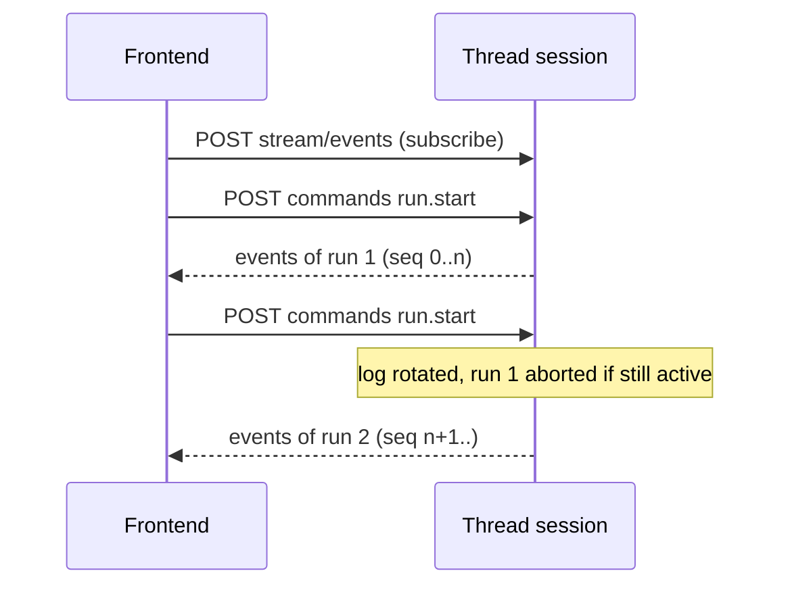

# Agent Streaming Protocol

Under `/agent` the harness speaks the [Agent Streaming Protocol](https://github.com/langchain-ai/agent-protocol/tree/main/streaming) v2, built on LangGraph `streamEvents` v3. A frontend that uses `useStream` from `@langchain/react` (or the Vue, Svelte and Angular bindings) with `HttpAgentServerAdapter` can talk to Neo directly. The implementation lives in [`src/agent-protocol.ts`](../src/agent-protocol.ts) and request schemas in `@neosaider/contracts`.

Only the subset needed by `useStream` is implemented. Agent Chat UI is **not** supported: it speaks the classic Agent Server API (`/runs/stream`), not v2.

## Auth and CORS

- Every `/agent/*` request needs `Authorization: Bearer <NEOSAIDER_API_TOKEN>`.
- `/agent/*` has CORS enabled for any origin (Hono `cors()` defaults). The CORS middleware runs before the bearer check, so preflight `OPTIONS` requests succeed without a token. Allowing any origin is safe because the API does not use cookies; every real request still carries the token.

## Routes

| Method   | Path                                     | Body schema                  | Response                         |
| -------- | ---------------------------------------- | ---------------------------- | -------------------------------- |
| `GET`    | `/agent/threads`                         | none                         | Thread summaries                 |
| `POST`   | `/agent/threads`                         | none                         | A new thread object              |
| `DELETE` | `/agent/threads/:threadId`               | none                         | `204`                            |
| `POST`   | `/agent/threads/:threadId/commands`      | `protocolCommandSchema`      | Command result                   |
| `POST`   | `/agent/threads/:threadId/stream/events` | `protocolSubscriptionSchema` | SSE of protocol events           |
| `GET`    | `/agent/threads/:threadId/state`         | none                         | Thread state, or `404`           |
| `POST`   | `/agent/threads/:threadId/state`         | `threadStateUpdateSchema`    | Thread state, or `422`           |
| `POST`   | `/agent/threads/:threadId/history`       | `threadHistoryRequestSchema` | Array of thread states, or `404` |

Bodies that fail their schema return `400` with the zod validation result.

### Threads

`GET /agent/threads` lists every checkpointed thread except proactive ones (`proactive:*`), newest first:

```json
[
  {
    "id": "8c1e…",
    "title": "What can you do?",
    "updatedAt": "2026-10-11T08:00:00.000Z"
  }
]
```

`title` is the first human message, trimmed to 80 characters, or `New conversation`. `updatedAt` is the creation time of the latest checkpoint. This route is a Neosaider extension used by the web chat sidebar.

`POST /agent/threads` returns `{ thread_id, status: "idle", metadata: {}, values: {}, created_at, updated_at }` with a random UUID. Nothing is stored until a run or a state update writes a checkpoint.

`DELETE /agent/threads/:threadId` drops the in-memory session and deletes the thread's checkpoints. It always returns `204`.

## Sessions

The harness keeps one in-memory session per thread id, created on first use and removed by `DELETE /agent/threads/:threadId`. A session holds:

- the current event log (a local `StreamChannel`),
- a sequence counter `seq`, monotonic for the life of the session,
- the active run, if any.

Sessions are lost on restart; the thread state is not, because it lives in the SQLite checkpointer.

## Commands

`POST /agent/threads/:threadId/commands` takes:

```json
{
  "id": 1,
  "method": "run.start",
  "params": { "input": { "messages": [{ "type": "human", "content": "hi" }] } }
}
```

`id` is a number or a string echoed back; `params` defaults to `{}`. `run.start` is the only supported method.

On `run.start` the harness:

1. Creates a `run_id` (UUID).
2. Rotates the session's event log: a new log replaces the current one and the previous log is closed.
3. Aborts the active run of the thread, if any.
4. Streams Neo's graph with `streamEvents` (`version: "v3"`) on `thread_id`, publishing each event into the new log.
5. After the run, queues memory extraction for the last exchange.

It answers immediately, before the run finishes:

```json
{ "type": "success", "id": 1, "result": { "run_id": "…" } }
```

Any other method answers with HTTP `200` and:

```json
{
  "type": "error",
  "id": 2,
  "error": "unknown_command",
  "message": "Unsupported command: agent.getTree"
}
```

A run that throws is logged to stderr; no error event is published.

## Event stream

`POST /agent/threads/:threadId/stream/events` takes a subscription with at least one channel; extra fields are passed through to LangGraph's `matchesSubscription`:

```json
{ "channels": ["values", "messages"] }
```

The response is `text/event-stream` (with `cache-control: no-cache, no-transform` and `x-accel-buffering: no`). Each frame is:

```text
id: <seq>
event: message
data: {"type":"event","seq":<seq>,"method":"…","params":{…}}
```

LangChain messages inside `params.data` and `params.interrupts` are converted to plain JSON (`{ ...data, type }`).

### Log rotation per run



- A subscriber reads the current log from the start, so it receives the whole current run even if it subscribed late. Events of earlier runs are not replayed.
- When a log is closed by rotation, the subscriber moves on to the new log, so one subscription follows consecutive runs.
- The stream never ends on its own; the client closes it.

## State

`GET /agent/threads/:threadId/state` returns the latest checkpoint in the SDK `ThreadState` shape:

```json
{
  "values": { "messages": [] },
  "next": [],
  "tasks": [],
  "checkpoint": {
    "thread_id": "…",
    "checkpoint_id": "…",
    "checkpoint_ns": "",
    "checkpoint_map": null
  },
  "metadata": {},
  "created_at": "…",
  "parent_checkpoint": null
}
```

A thread without checkpoints returns `404` with `{ "error": "not_found", "message": "Thread <id> not found" }`.

`POST /agent/threads/:threadId/state` writes state with `updateState`. Body: `values` (object, optional; defaults to `{ "messages": [] }`) and `as_node` (optional; defaults to `__start__`). An empty body therefore bootstraps an empty thread. Responds with the new state, or `422` with `{ "error": "invalid_state_update", "message" }` when LangGraph rejects the update.

## History

`POST /agent/threads/:threadId/history` returns the checkpoint history as an array of thread states, newest first. Body:

| Field    | Type                                  | Rules                |
| -------- | ------------------------------------- | -------------------- |
| `limit`  | integer                               | 1 to 100, default 10 |
| `before` | string or `{ checkpoint_id: string }` | Optional, nullable   |

A thread without checkpoints returns `404` as in `GET /state`.

## Using it from useStream

Against the harness directly (the token is then visible to the browser, so do this only for local tools):

```tsx
import { HttpAgentServerAdapter, useStream } from "@langchain/react";

const stream = useStream({
  transport: new HttpAgentServerAdapter({
    apiUrl: "http://localhost:3000/agent",
    defaultHeaders: { Authorization: `Bearer ${token}` },
  }),
});

void stream.submit({ messages: [{ type: "human", content: "hi" }] });
```

The web app does not expose the token: it points the adapter's `commands`, `stream` and `state` paths at its own `/api/harness/agent/...` proxy, which adds the token on the server. See [the web README](../../web/README.md).

## Raw example

```sh
curl -N $API/agent/threads/demo/stream/events \
  -H "Authorization: Bearer $TOKEN" -H "Content-Type: application/json" \
  -d '{"channels":["values"]}' &

curl $API/agent/threads/demo/commands \
  -H "Authorization: Bearer $TOKEN" -H "Content-Type: application/json" \
  -d '{"id":1,"method":"run.start","params":{"input":{"messages":[{"type":"human","content":"hi"}]}}}'
```
