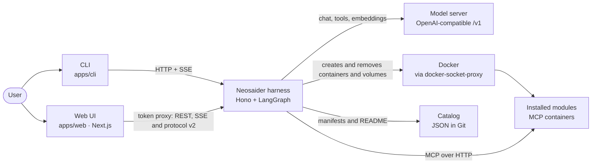
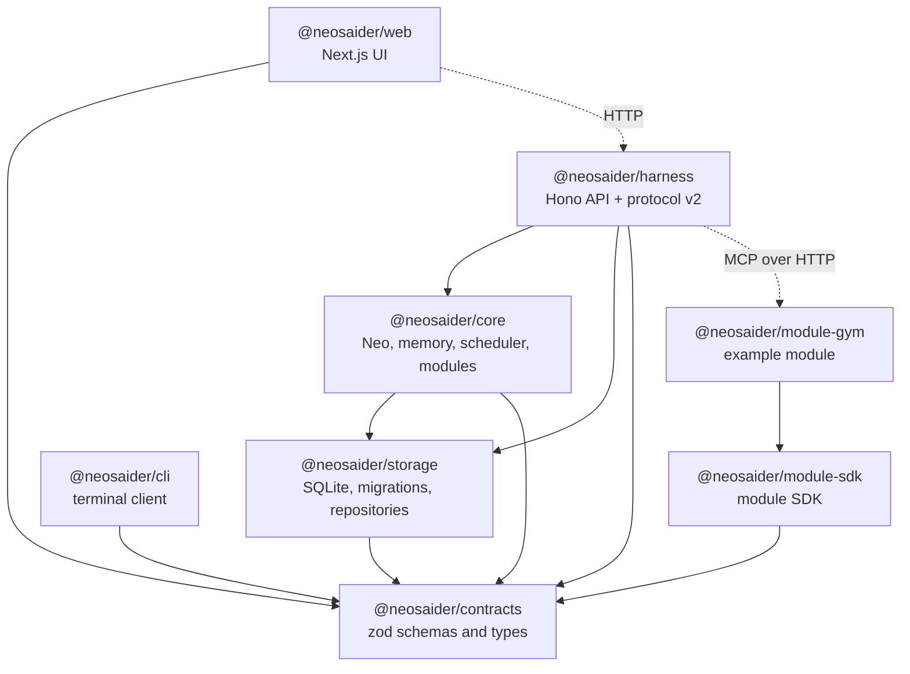
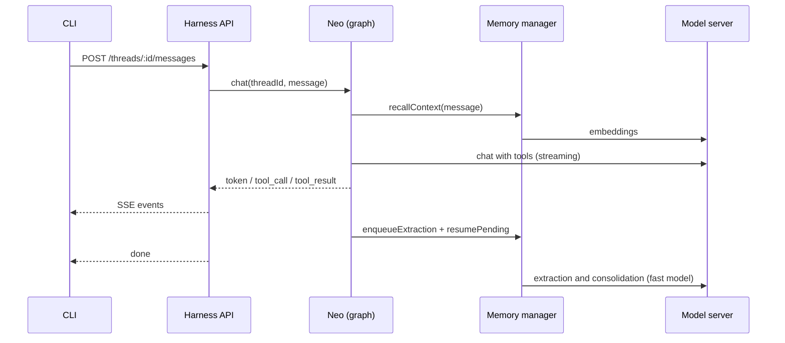
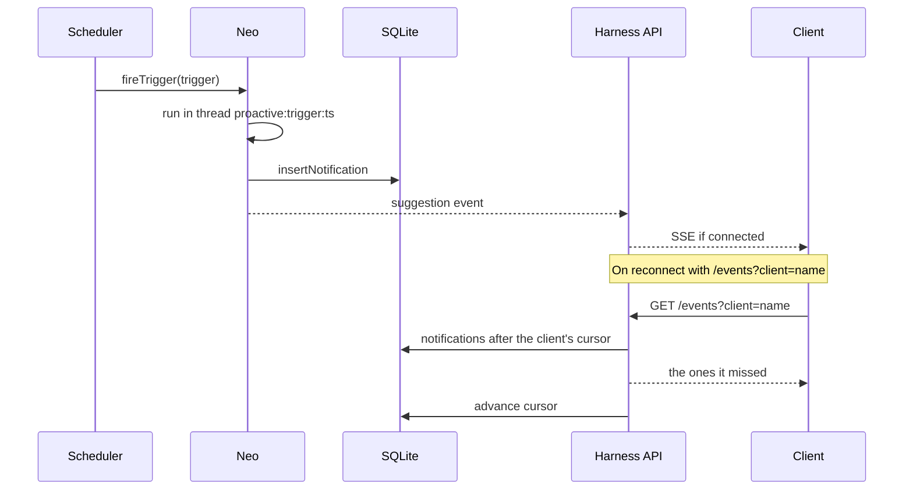
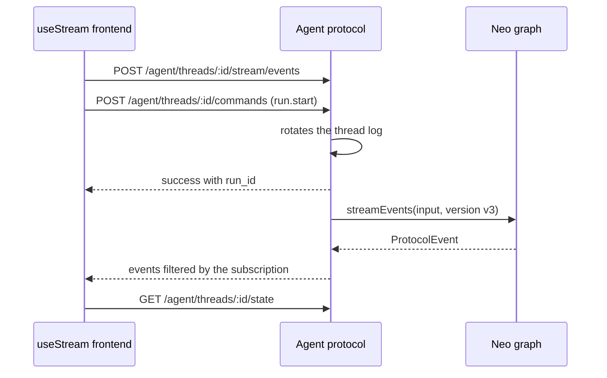
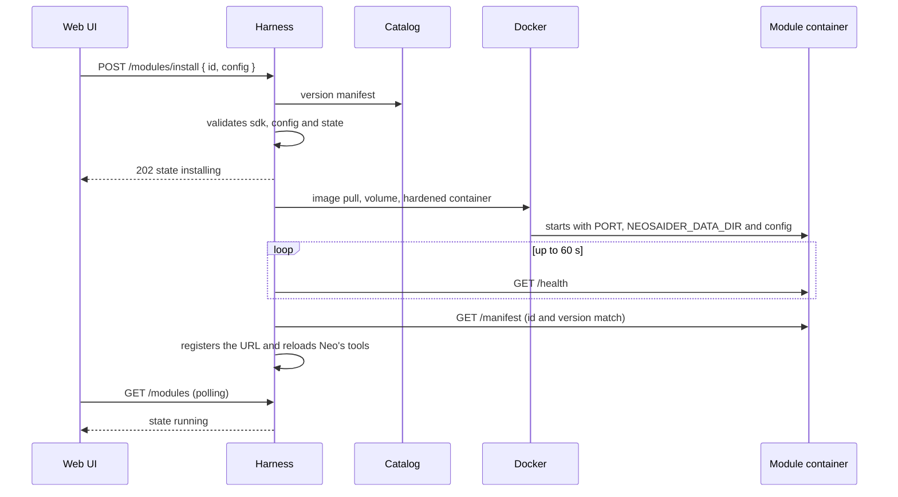
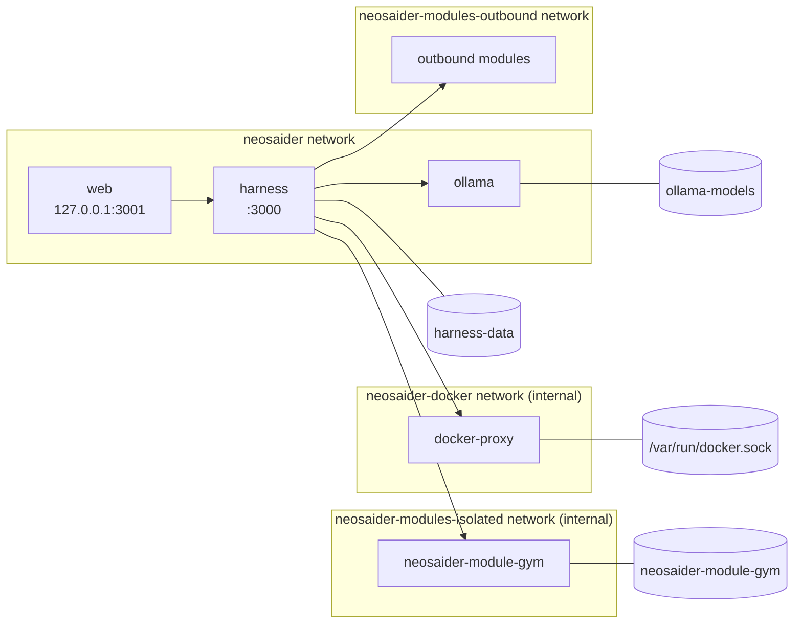

# Neosaider architecture

This document follows the [arc42](https://arc42.org) template. The visual view is in the [interactive diagram](./architecture.html). The reference material lives elsewhere: the [REST API](../apps/harness/docs/API.md), the [Agent Streaming Protocol](../apps/harness/docs/AGENT-PROTOCOL.md), the [CLI](../apps/cli/README.md), and getting started and Docker in the [README](../README.md).

Rendered diagrams (SVG) of the [system context](./diagrams/system-context.svg), the [package layers](./diagrams/package-layers.svg), a [chat turn](./diagrams/chat-turn.svg) and a [module install](./diagrams/module-install.svg) live in [`./diagrams/`](./diagrams/). Their sources are the `.html` files next to them.

## 1. Introduction and goals

Neosaider is the headless harness of **Neo**, a personal assistant built with LangGraph JS. The harness has no interface of its own: it exposes an HTTP API with SSE streaming that is consumed by the repository's CLI and by any frontend using `useStream`.

Neo converses, remembers what it learns about the user, schedules tasks and reminders, and extends its capabilities with MCP modules.

### Quality goals

| Priority | Goal          | What it means here                                                                                    |
| -------- | ------------- | ----------------------------------------------------------------------------------------------------- |
| 1        | Local-first   | Works with local models and a single SQLite file, with no paid services or additional infrastructure. |
| 2        | Durability    | A restart loses no conversations, memories, tasks, notifications or pending extractions.              |
| 3        | Extensibility | Adding a domain capability means registering an MCP server, without touching the core.                |
| 4        | Simplicity    | One user, one process and one data file. Every new piece has to justify its cost.                     |

### Stakeholders

| Role            | Expectation                                                                  |
| --------------- | ---------------------------------------------------------------------------- |
| User (single)   | An assistant that knows them, notifies them on time and streams its answers. |
| Module author   | A stable contract (MCP over HTTP) to expose domain tools.                    |
| Frontend author | A standard protocol (Agent Streaming Protocol v2) to use `useStream`.        |

## 2. Constraints

| Constraint                          | Reason                                                                           |
| ----------------------------------- | -------------------------------------------------------------------------------- |
| Node.js ≥ 24 and TypeScript         | LangGraph JS, the MCP SDK and Hono are native to this ecosystem.                 |
| pnpm + Turborepo monorepo           | Layered packages enforced by `turbo boundaries`.                                 |
| Models via an OpenAI-compatible API | A single URL (`NEO_LLM_BASE_URL`) works for llama.cpp, Jan, LM Studio or Ollama. |
| SQLite as the only store            | No Redis or separate vector database; `sqlite-vec` covers semantic search.       |
| Single user with a bearer token     | It is a personal assistant; there is no multi-tenancy or user management.        |

## 3. Context and scope

| Neighbor               | Interface                                                                                                               |
| ---------------------- | ----------------------------------------------------------------------------------------------------------------------- |
| CLI                    | REST + SSE: `/threads/:id/messages`, `/events?client=`, `/modules`, `/triggers`, `/memories`.                           |
| Web UI and `useStream` | `/agent/threads/:id/commands`, `/stream/events`, `/state`, `/history`; store and modules via `/catalog` and `/modules`. |
| Docker                 | Docker Engine API through `dockerode`, restricted by `docker-socket-proxy`.                                             |
| Catalog                | JSON and manifests over HTTPS or a local file ([format](./CATALOG.md)).                                                 |
| Model server           | `/v1/chat/completions`, `/v1/embeddings` and `/v1/models` (health).                                                     |
| MCP modules            | Streamable HTTP; the harness is the MCP client.                                                                         |

Out of scope: multi-user authentication, exposing the UI outside the machine, and the classic Agent Server protocol (`/runs/stream`), which Agent Chat UI depends on.

## 4. Solution strategy

| Problem               | Decision                                                                                                  |
| --------------------- | --------------------------------------------------------------------------------------------------------- |
| Orchestrate the agent | A LangGraph `StateGraph` (`recall → agent ⇄ tools`) with per-thread checkpoints.                          |
| Talk to clients       | Hono with POST for commands and SSE for streaming and notifications.                                      |
| Persist everything    | One SQLite file: checkpoints, memories with vectors, modules, tasks and notifications.                    |
| Domain capabilities   | MCP modules in their own process. Internal capabilities (memory, tasks) are core tools.                   |
| Proactivity           | A croner-based scheduler that runs Neo in `proactive:*` threads and leaves the answer in an inbox.        |
| Long-term memory      | Extraction and consolidation with a fast model after each run, and semantic recall before answering.      |
| Third-party frontends | Agent Streaming Protocol v2 at `/agent`, on top of LangGraph `streamEvents` v3.                           |
| Install modules       | Catalog in Git + one manifest per module; each module is a hardened Docker container with its own volume. |
| Interface             | Local Next.js UI that keeps the token on the server and proxies to the harness.                           |

## 5. Building block view

### Level 1: packages and layers

| Layer (turbo tag) | Packages               | May depend on            |
| ----------------- | ---------------------- | ------------------------ |
| `layer-contracts` | `packages/contracts`   | toolchain                |
| `layer-sdk`       | `packages/module-sdk`  | contracts                |
| `layer-storage`   | `packages/storage`     | contracts                |
| `layer-core`      | `packages/core`        | contracts, storage       |
| `layer-api`       | `apps/harness`         | contracts, storage, core |
| `layer-module`    | `modules/*`            | contracts, sdk           |
| `layer-client`    | `apps/cli`, `apps/web` | contracts                |

The CLI and the UI only know the contracts and talk to the harness over HTTP; they never import the core. Modules only depend on the SDK: the harness talks to them over MCP at runtime. How to build one: [Creating a module](../packages/module-sdk/docs/CREATING-A-MODULE.md).

### Level 2: inside the harness and the core

| Block            | Responsibility                                                                                                                                                     | Code                                                           | Docs                                                                               |
| ---------------- | ------------------------------------------------------------------------------------------------------------------------------------------------------------------ | -------------------------------------------------------------- | ---------------------------------------------------------------------------------- |
| Harness API      | REST + SSE routes, bearer token, zod validation and the `/events` inbox.                                                                                           | `apps/harness/src/app.ts`                                      | [API](../apps/harness/docs/API.md)                                                 |
| Agent protocol   | Per-thread session, `run.start` commands, v2 event log, state and history in the SDK format.                                                                       | `apps/harness/src/agent-protocol.ts`                           | [Agent protocol](../apps/harness/docs/AGENT-PROTOCOL.md)                           |
| Neo              | Builds the graph, runs chats and runs, fires tasks and exposes notifications, threads and retention.                                                               | `packages/core/src/neo.ts`, `graph.ts`                         | [Agent](../packages/core/docs/AGENT.md)                                            |
| Self-description | System prompt with the modules, tasks, time and memory state at the moment of each answer.                                                                         | `packages/core/src/self-description.ts`                        | [Agent](../packages/core/docs/AGENT.md)                                            |
| Memory manager   | `remember`/`recall` tools, memory context before answering and extraction with a persisted queue.                                                                  | `packages/core/src/memory.ts`                                  | [Memory](../packages/core/docs/MEMORY.md)                                          |
| Scheduler        | `once`, `cron` and `session.start` tasks with croner and an event bus.                                                                                             | `packages/core/src/scheduler.ts`, `scheduling.ts`, `events.ts` | [Scheduler](../packages/core/docs/SCHEDULER.md)                                    |
| Module manager   | One `MCPAdapter` per HTTP module; its tools are added to the graph, which is rebuilt when modules are registered or removed. Retries unresponsive ones every 15 s. | `packages/core/src/modules.ts`                                 | [Module runtime](../packages/core/docs/MODULE-RUNTIME.md)                          |
| Catalog          | Reads the catalog and the manifests (file or HTTPS), validates them and caches them for 5 minutes.                                                                 | `packages/core/src/catalog.ts`                                 | [Module runtime](../packages/core/docs/MODULE-RUNTIME.md), [Catalog](./CATALOG.md) |
| Installer        | Installs, updates, configures, uninstalls and reconciles modules; stores their state in `installed_modules`.                                                       | `packages/core/src/module-installer.ts`                        | [Module runtime](../packages/core/docs/MODULE-RUNTIME.md)                          |
| Docker runtime   | Image, volume and hardened container per module; isolated or outbound networks; logs.                                                                              | `packages/core/src/module-runtime.ts`                          | [Module runtime](../packages/core/docs/MODULE-RUNTIME.md)                          |
| Module SDK       | `defineModule` and `startModule`: stateless MCP, `/health`, `/manifest`, `/readme`, `Host` validation.                                                             | `packages/module-sdk/src/index.ts`                             | [Module SDK](../packages/module-sdk/README.md)                                     |
| Web UI           | Chat with `useStream`, store, module management and notifications; `/api/harness/*` proxy that adds the token.                                                     | `apps/web/`                                                    | [Web UI](../apps/web/README.md)                                                    |
| Models           | Chat client, fast model and embeddings over the OpenAI-compatible URL.                                                                                             | `packages/core/src/models.ts`                                  | [Agent](../packages/core/docs/AGENT.md)                                            |
| Storage          | Migrations by `user_version` and repositories for memories, modules, tasks, notifications and extractions.                                                         | `packages/storage/src/`                                        | [Data model](../packages/storage/docs/DATA-MODEL.md)                               |

## 6. Runtime view

### Chat over SSE

### Scheduled task and notification

### Agent Streaming Protocol v2 run

### Module installation

Uninstalling follows the reverse path: it removes the registration, reloads the tools and deletes the container and, unless `keepData=true`, the volume.

### Memory extraction

1. When a run finishes successfully (chat, v2 run or scheduled task), the last exchange is saved in `pending_extractions`.
2. The queue, serialized in memory, processes the extraction with the fast model. On success it deletes the row; on failure it adds one attempt.
3. Pending rows are only retried after another successful run, when there is proof that the LLM is responding. Three failures under those conditions discard the entry.

## 7. Deployment view

### Local

| Process                  | Command                                | Notes                                                                 |
| ------------------------ | -------------------------------------- | --------------------------------------------------------------------- |
| Model server             | Ollama, llama.cpp, Jan or LM Studio    | `NEO_LLM_BASE_URL`, chat, fast and embedding models.                  |
| Docker Desktop or Engine | —                                      | Optional: without it the store is visible, but nothing installs.      |
| Harness                  | `pnpm --filter @neosaider/harness dev` | Reads `.env`; creates `neosaider.db`; catalog `modules/catalog.json`. |
| Web UI                   | `pnpm --filter @neosaider/web dev`     | `http://127.0.0.1:3001`; reads the token from the root `.env`.        |
| CLI                      | `pnpm --filter @neosaider/cli start`   | `NEOSAIDER_CLIENT` identifies the machine.                            |

Locally, module containers publish their port on `127.0.0.1` and the harness connects through it; they are not isolated from the network.

### Docker Compose

- `web`, `harness` and `module-gym` are built from the same `Dockerfile` with `turbo prune` and `pnpm deploy`, choosing the package with `ARG PACKAGE`. The UI uses the `web` stage, on top of Next's `standalone` output.
- Module containers are **not** in `docker-compose.yml`: the harness creates them when installing. The `module-gym` service (profile `modules`) only exists to build its image with `docker compose --profile modules build`.
- The harness joins `neosaider-modules-isolated` and `neosaider-modules-outbound` to reach modules. Modules never join `neosaider` or `neosaider-docker`, so they cannot reach `web`, `docker-proxy` or `ollama`.
- `docker-proxy` lives on the internal `neosaider-docker` network, shared only with the harness.
- Each installed module gets its own credential (`NEOSAIDER_MODULE_TOKEN`, derived from the API token), which the SDK requires on every request.
- The development catalog is mounted read-only at `/catalog`.

## 8. Cross-cutting concepts

### Persistence

Everything lives in a SQLite file opened with `better-sqlite3` in WAL mode and with `sqlite-vec` loaded. Migrations are an array in `packages/storage/src/migrations.ts`; `user_version` records how many have been applied, and only new entries are added. LangGraph checkpoints use the same file through `SqliteSaver`.

### Security

- A single `NEOSAIDER_API_TOKEN` protects every route except `/health`.
- `/agent/*` allows CORS from any origin because every request still needs the token, and no cookies are used.
- The UI has no authentication of its own: it keeps the token on the Next server, acts as a proxy and listens only on `127.0.0.1`. Anyone who can reach that port controls the harness, so it must not be exposed, and on a multi-user host every local OS user can use it.
- `apps/web/proxy.ts` answers `403` to any request whose `Host` hostname is not `localhost`, `127.0.0.1`, `[::1]` or listed in `NEOSAIDER_WEB_ALLOWED_HOSTS` (DNS rebinding, container names such as `web`). On `/api/harness/*` it also rejects `Sec-Fetch-Site: cross-site` or `same-site` and any `Origin` outside that list (CSRF).
- The harness answers `415` to mutations whose body is not `application/json`, so cross-site simple requests cannot reach the zod validators as `{}`.
- The harness talks to Docker through `docker-socket-proxy`, which only allows containers, images, volumes, networks and starting containers; `exec`, `build`, secrets and swarm stay closed. Creating containers is still a powerful capability.
- Module containers are created with a read-only file system (except `/data` and a 64 MB `/tmp`), no Linux capabilities, `no-new-privileges` and 256 MB of memory. If their network is isolated, they have no egress.
- Each module validates the `Host` header against its own name (protection against DNS rebinding).

### Validation

API inputs are validated with zod schemas defined in `@neosaider/contracts` and applied with `@hono/zod-validator`. The same schemas type the CLI.

### Retention

Every day at 04:00 and on startup, `proactive:*` threads and delivered notifications older than 7 days are deleted. User conversations are never deleted.

### Testing

`node --test` on the compiled code, with fake models (`ScriptedChatModel`, `FakeListChatModel`, deterministic embeddings) and in-memory SQLite. No LLM is needed to run the suite.

## 9. Architecture decisions

### SSE instead of WebSocket

- **Context:** clients need token streaming and proactive notifications.
- **Decision:** commands over POST and streaming over SSE (`/threads/:id/messages`, `/events`, `/agent/.../stream/events`).
- **Consequences:** works with `fetch` and ordinary HTTP proxies; there is no bidirectional channel, and none is needed.

### A single SQLite file

- **Context:** a personal, local-first assistant.
- **Decision:** checkpoints, memories with vectors (`sqlite-vec`), modules, tasks, notifications and queues in one file.
- **Consequences:** trivial backups and zero infrastructure; a single writer process.

### MCP modules over HTTP only

- **Context:** a `stdio` module ran commands on the host, so the token amounted to root access.
- **Decision:** the `stdio` transport was removed; modules are independent HTTP MCP servers.
- **Consequences:** isolation per process or container; a local module needs to run its own server.

### Agent Streaming Protocol v2 instead of the classic protocol

- **Context:** the goal was to use `useStream` from `@langchain/react`.
- **Decision:** implement v2 (`commands`, `stream/events`, `state`, `history`) on top of `streamEvents` v3.
- **Consequences:** compatible with `HttpAgentServerAdapter`; Agent Chat UI, which uses the classic protocol, does not work.

### Notifications with a per-client cursor

- **Context:** a pending notification was only received by the first client to connect.
- **Decision:** each client identifies itself with `?client=` and the server stores its cursor in `notification_cursors`.
- **Consequences:** each machine receives what it missed, with no client-side state. A new client starts with what nobody has received.

### Extraction retry after a successful run

- **Context:** with the LLM down, retries on startup used up attempts and ended up losing memories.
- **Decision:** pending extractions are retried after each successful run, never on startup.
- **Consequences:** attempts are only spent when the LLM responds; three failures indicate an entry that cannot be processed.

### v2 event log rotated per run

- **Context:** the in-memory log grew per thread without limit.
- **Decision:** each `run.start` closes the previous log and opens a new one; open subscriptions move to the new one automatically.
- **Consequences:** memory bounded to the last run of each thread; the full state remains in `/state` and `/history`.

### Modules as managed containers

- **Context:** registering a module by URL leaves its process, its data and its lifecycle outside the harness. A store where third-party modules (gym, finance, home automation) can be installed and uninstalled needs the harness to manage them.
- **Decision:** each module installed from the [catalog](./CATALOG.md) is a Docker container `neosaider-module-<id>` with a volume `neosaider-module-<id>`. The harness talks to Docker with `dockerode`, through `docker-socket-proxy` in Compose. Installing pulls the image, creates the volume and the container, waits for `/health` and checks `/manifest`. Uninstalling deletes the container and, by default, the volume. Modules are built with `@neosaider/module-sdk` and declare a `neosaider.module.json` manifest (see [Creating a module](../packages/module-sdk/docs/CREATING-A-MODULE.md)). Manual registration by URL remains available for external modules, whose container the harness does not manage.
- **Consequences:**
  - Per-module isolation and data that can be deleted in one go.
  - Containers are created hardened: read-only file system, no capabilities, `no-new-privileges` and a memory limit.
  - Whoever controls the harness controls part of Docker; the proxy limits the API to containers, images, volumes and networks.
  - Configuration secrets are stored in plain text in the local database.

## 10. Quality requirements

| Scenario                               | Expected response                                                                               |
| -------------------------------------- | ----------------------------------------------------------------------------------------------- |
| The user sends a message               | Tokens arrive over SSE while the model generates, with tool calls interleaved.                  |
| The harness restarts                   | Conversations, memories, tasks, modules, pending notifications and extractions are still there. |
| The LLM is down                        | `/health` returns `llm: false`, the chat reports the error and no extractions are lost.         |
| A task fires with no clients connected | The notification waits in the inbox and each client receives it when it connects.               |
| An MCP module is registered            | Its tools are available in the next answer, without a restart.                                  |
| A module is installed from the store   | Within seconds it becomes "running" and Neo can use its tools.                                  |
| A module is uninstalled                | Neither its container nor its volume remains.                                                   |
| A module crashes or restarts           | The harness reconnects it on its own in under 15 seconds.                                       |

## 11. Risks and technical debt

| Risk                             | Impact                                                         | Current mitigation                                                               |
| -------------------------------- | -------------------------------------------------------------- | -------------------------------------------------------------------------------- |
| Quality of local models          | Poor tool calls or extractions with small models.              | Separately configurable fast model (`NEO_FAST_MODEL`).                           |
| No classic Agent Server protocol | Agent Chat UI and clients based on `/runs/stream` do not work. | Implement it if needed; v2 covers `useStream`.                                   |
| A single SQLite writer process   | Does not scale horizontally.                                   | Accepted: it is a single-user assistant.                                         |
| Harness access to Docker         | A leaked token allows creating containers on the host.         | `docker-socket-proxy` with the minimal API; hardened containers.                 |
| Unreviewed third-party modules   | Foreign code with access to the network and its volume.        | Manifest permissions shown before installing; network per `permissions.network`. |
| Module secrets in plain text     | Secret configuration is readable in the local database.        | Accepted: single-user local database.                                            |

## 12. Glossary

| Term             | Meaning                                                                                            |
| ---------------- | -------------------------------------------------------------------------------------------------- |
| Harness          | The server that hosts Neo and exposes the API (`apps/harness`).                                    |
| Neo              | The agent: a LangGraph graph with memory, tasks and modules.                                       |
| Thread           | A conversation identified by `thread_id`, with its history in checkpoints.                         |
| Proactive thread | A `proactive:<trigger>:<ms>` thread created when a task fires; deleted after 7 days.               |
| Checkpoint       | A snapshot of the graph state that `SqliteSaver` stores after each step.                           |
| Trigger          | A scheduled task: `once`, `cron` or `event` (`session.start`).                                     |
| Notification     | Neo's answer to a trigger, stored in the inbox and delivered through `/events`.                    |
| Client cursor    | The last notification a specific client has received (`notification_cursors`).                     |
| Module           | An MCP server that provides domain tools to Neo; managed (installed from the catalog) or external. |
| Manifest         | `neosaider.module.json`: identity, version, image, configuration and permissions of a module.      |
| Catalog          | A JSON file versioned in Git that lists the modules and points to their manifests.                 |
| Memory           | A durable fact about the user (`profile` or `fact`) with its embedding.                            |
