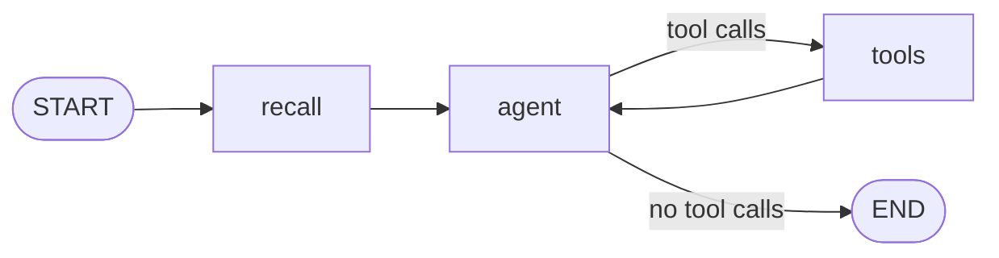

# Neo agent

Neo is a LangGraph `StateGraph` built by `buildNeoGraph` (`src/graph.ts`) and wired by `createNeo` (`src/neo.ts`).

## State

| Channel         | Type                    | Content                                               |
| --------------- | ----------------------- | ----------------------------------------------------- |
| `messages`      | `MessagesValue`         | Conversation messages, persisted by the checkpointer. |
| `memoryContext` | `string` (default `""`) | Memories recalled for the latest user message.        |

## Graph

| Node     | What it does                                                                                                                            |
| -------- | --------------------------------------------------------------------------------------------------------------------------------------- |
| `recall` | Takes the last `HumanMessage` and sets `memoryContext` to `memory.recallContext(text)` (empty string when memory is disabled).          |
| `agent`  | Invokes the chat model (with tools bound when there are any) on `SystemMessage(instructions + "\n\n" + memoryContext)` plus `messages`. |
| `tools`  | Prebuilt `ToolNode` with `handleToolErrors: true`, so a failing tool returns an error message to the model instead of aborting the run. |

The edge out of `agent` is the prebuilt `toolsCondition`. The graph is compiled with the SQLite checkpointer from `@neosaider/storage`, so each `thread_id` keeps its state across restarts.

The graph is rebuilt (`build()` in `neo.ts`) whenever the set of module tools changes: after `modules.register`, `modules.unregister`, any installer change, and when the reconnection loop recovers a module. A running `chat` keeps the graph it started with.

## Tools

The tool list is the built-in tools (`memory.tools` and the scheduling tools) followed by `modules.tools()`.

`schedule_task`, `cancel_scheduled_task` and `remember` act on the user's behalf, so `buildNeoGraph` wraps them: when the current turn (the messages after the last `HumanMessage`) already holds a `ToolMessage` from a module tool (any tool that is not built-in), they return `MODULE_OUTPUT_REFUSAL` to the model and do nothing. The user has to ask again in a new message.

| Tool                    | Source              | Arguments                                            | Notes                                                                                                    |
| ----------------------- | ------------------- | ---------------------------------------------------- | -------------------------------------------------------------------------------------------------------- |
| `remember`              | `src/memory.ts`     | `content`, `kind` (`profile` or `fact`)              | Only present when an embeddings model is configured. Goes through consolidation.                         |
| `recall`                | `src/memory.ts`     | `query`                                              | Only with embeddings. Returns up to 5 `fact` memories.                                                   |
| `schedule_task`         | `src/scheduling.ts` | `task`, and exactly one of `inSeconds`, `at`, `cron` | `inSeconds`/`at` create a `once` trigger, `cron` a `cron` trigger. `at` must be in the future.           |
| `list_scheduled_tasks`  | `src/scheduling.ts` | none                                                 | Lists every trigger.                                                                                     |
| `cancel_scheduled_task` | `src/scheduling.ts` | `id`                                                 | Deletes a trigger.                                                                                       |
| `<module>_<tool>`       | MCP modules         | Defined by the module                                | Loaded through `MCPAdapter` with `prefixToolNameWithServerName: true`. Names that collide are not bound. |

See [MEMORY.md](./MEMORY.md), [SCHEDULER.md](./SCHEDULER.md) and [MODULE-RUNTIME.md](./MODULE-RUNTIME.md).

## System prompt

`describeNeosaider` (`src/self-description.ts`) is evaluated on every `agent` call, so the prompt always reflects the live state:

- Identity: Neo, the agent of a self-hosted, headless harness; reply in the user's language, concise and direct.
- Capabilities are exactly the listed tools; no web access or file system.
- Modules: each loaded module with its tools, or `unavailable right now: <error>`; when there are none, it says so.
- Long-term memory: enabled or disabled depending on whether an embeddings model exists, with guidance on `remember` and `recall`.
- Scheduled tasks: how to use the scheduling tools and the list of current triggers.
- Current time, formatted with `sv-SE` locale in the process time zone (`Intl.DateTimeFormat().resolvedOptions().timeZone`).

Recalled memories are appended after these instructions by the `agent` node.

## Models

`createModels` (`src/models.ts`) builds every model with `ChatOpenAI`/`OpenAIEmbeddings` from `@langchain/openai` against one OpenAI-compatible `baseUrl` (Ollama by default in the harness), with `maxRetries: 1`.

| Model        | Setting      | Used for                                                                          |
| ------------ | ------------ | --------------------------------------------------------------------------------- |
| `chat`       | `chatModel`  | The `agent` node.                                                                 |
| `fast`       | `fastModel`  | Memory extraction and consolidation, with `temperature: 0` and structured output. |
| `embeddings` | `embedModel` | Optional. Without it, memory is disabled.                                         |

## Threads

| Thread                                | Created by                       | Visible in `threadIds()` |
| ------------------------------------- | -------------------------------- | ------------------------ |
| Any id chosen by the client           | `chat`, `run` or the API         | Yes                      |
| `proactive:<triggerId>:<epochMillis>` | A trigger firing (`fireTrigger`) | No                       |

`chat` streams with `streamMode: ["messages", "updates"]`: `token` events come from message chunks of the `agent` node, `tool_call` and `tool_result` from node updates. After the stream ends it queues memory extraction of the last exchange and yields `done`; any error yields `error`.

A proactive run sends the model `Scheduled task #<id> is due now. ... Task: <prompt>` on a new proactive thread. Its final text is stored as a notification and emitted on the bus as a `suggestion` event.

## Retention

`pruneProactiveThreads` runs once at startup and then daily at 04:00 (`0 4 * * *`, croner with `protect: true`). It deletes:

- Proactive threads whose timestamp is older than 7 days (through `checkpointer.deleteThread`).
- Delivered notifications delivered more than 7 days ago. Undelivered notifications are kept.

User threads are never pruned.
