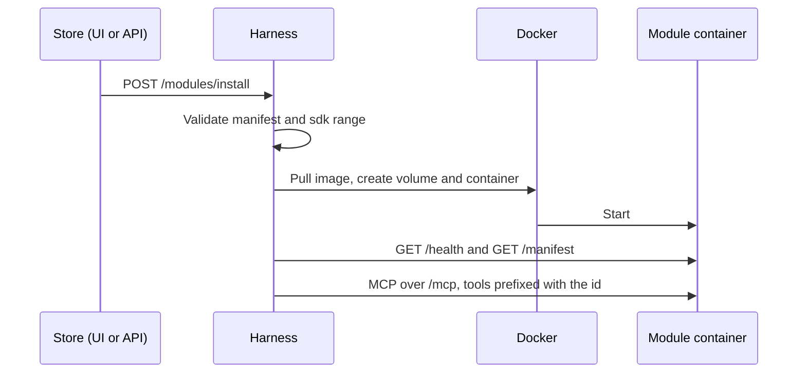

# Creating a module

A module gives Neo domain tools: workouts, finances, nutrition, home automation… Technically it is an **HTTP MCP server** packaged as a **Docker image** and described by a **manifest**. From the [store](../../../docs/CATALOG.md), the harness installs it in its own container with its own data volume, and removes it entirely on uninstall. The reasons behind this design are in [Architecture decisions](../../../docs/ARCHITECTURE.md#9-architecture-decisions).

There are two reference modules in the monorepo:

- [`modules/_template`](../../../modules/_template): the minimal starting point, with one tool and one config value.
- [`modules/gym`](../../../modules/gym): a real module with its own database.

The SDK API itself is documented in the [module SDK README](../README.md).

## How it works

1. The user picks the module in the UI store (or calls `POST /modules/install`).
2. The harness validates the manifest, pulls the image and creates the `neosaider-module-<id>` volume and the `neosaider-module-<id>` container. It then starts it and waits until `GET /health` responds and `GET /manifest` matches the catalog.
3. It registers the module and Neo receives its tools prefixed with the `id`: `log_workout` from the `gym` module becomes `gym_log_workout`. Neo's system prompt describes it from the next response on, without restarting anything.
4. On startup the harness reconciles: it starts stopped containers again and, every 15 seconds, reconnects to modules that do not respond.
5. Uninstalling removes the container and, unless asked to keep it, the volume with all its data.



## Manifest

Every module has a `neosaider.module.json` at its root, validated with `moduleManifestSchema` from `@neosaider/contracts`. Its JSON Schema is published at [`docs/schemas/module-manifest.schema.json`](../../../docs/schemas/module-manifest.schema.json); referencing it with `$schema` gives editor autocompletion.

```json
{
  "$schema": "../../docs/schemas/module-manifest.schema.json",
  "id": "gym",
  "name": "Gym",
  "version": "0.1.0",
  "description": "Registra tus entrenamientos y consulta lo que has hecho en los últimos días.",
  "tags": ["fitness", "health"],
  "author": "Neosaider",
  "license": "MIT",
  "icon": "🏋️",
  "sdk": "^0.1.0",
  "image": "neosaider/module-gym:0.1.0",
  "port": 8080,
  "dataPath": "/data",
  "permissions": { "network": "isolated" }
}
```

| Field                    | Required | Description                                                                                                                                  |
| ------------------------ | -------- | -------------------------------------------------------------------------------------------------------------------------------------------- |
| `id`                     | yes      | Starts with a lowercase letter; then lowercase letters, digits, `-` or `_` (up to 32). Tool prefix and the name of the container and volume. |
| `name`                   | yes      | Name shown in the store (up to 64 characters).                                                                                               |
| `version`                | yes      | Semver version of this release.                                                                                                              |
| `description`            | yes      | One or two sentences (up to 300 characters).                                                                                                 |
| `tags`                   | no       | Up to 10 lowercase tags; the store filters by them.                                                                                          |
| `author`, `license`      | yes      | Authorship and license.                                                                                                                      |
| `homepage`, `repository` | no       | URLs shown by the store.                                                                                                                     |
| `icon`                   | no       | An emoji.                                                                                                                                    |
| `sdk`                    | yes      | Semver range of compatible SDK versions; the harness refuses to install it if its own version does not satisfy it.                           |
| `image`                  | yes      | Reference of the Docker image to install.                                                                                                    |
| `port`                   | no       | Port it listens on inside the container (default `8080`).                                                                                    |
| `dataPath`               | no       | Absolute path of the volume inside the container (default `/data`).                                                                          |
| `config`                 | no       | Configuration requested at install time; see below.                                                                                          |
| `permissions.network`    | no       | `isolated` (default) or `outbound`; see below.                                                                                               |

### Configuration

Each `config` entry becomes an environment variable of the container:

```json
{
  "key": "HOME_ASSISTANT_TOKEN",
  "description": "Home Assistant long-lived access token.",
  "required": true,
  "secret": true
}
```

- `key` is `UPPER_SNAKE_CASE`. `PORT`, `HOST` and `NEOSAIDER_*` are reserved.
- `required` without a `default` must be filled in at install time.
- `secret` makes the UI ask for it as a password and the API return it masked. It is stored in plain text in the harness's local database.

### Network permissions

| Value      | What the container can do                                                  | Use it for                                        |
| ---------- | -------------------------------------------------------------------------- | ------------------------------------------------- |
| `isolated` | Only the harness reaches it, on an internal Docker network with no egress. | Modules that only store and query their own data. |
| `outbound` | It can also open connections to the internet and your local network.       | External APIs, home automation, home devices.     |

The store shows the permission before installing. Isolation applies when the harness runs in Docker Compose. With the harness on the host (development), containers publish their port on `127.0.0.1` and are not isolated.

## Step by step

The examples create a `notes` module.

### 1. Copy the template

```sh
cp -r modules/_template modules/notes
rm -rf modules/notes/dist modules/notes/node_modules modules/notes/.turbo
```

In `modules/notes/package.json` change the name to `@neosaider/module-notes`, and in `neosaider.module.json` change `id`, `name`, `description`, `tags`, `image` (`neosaider/module-notes:0.1.0`) and `config`. Then run `pnpm install`: the workspace already includes `modules/*`.

A module depends only on `@neosaider/module-sdk`, `@neosaider/contracts` and external libraries. `turbo boundaries` prevents it from importing `core` or `storage`: it is a separate process that only speaks MCP.

### 2. Define the module (`src/notes.ts`)

```ts
import { join } from "node:path";
import { defineModule } from "@neosaider/module-sdk";
import { z } from "zod";

export const notesModule = defineModule({
  root: new URL("..", import.meta.url),
  create({ dataDir, config, log }) {
    const db = openNotesDatabase(join(dataDir, "notes.db"));
    return {
      register(server) {
        server.registerTool(
          "add_note",
          {
            title: "Add note",
            description: "Save a short note for the user.",
            inputSchema: z.object({ text: z.string().min(1) }),
          },
          async ({ text }) => ({
            content: [
              { type: "text", text: JSON.stringify(addNote(db, text)) },
            ],
          }),
        );
      },
      close: () => db.close(),
    };
  },
});
```

- `defineModule` reads `neosaider.module.json` and `README.md` from `root` and validates the manifest. Without a `README.md`, it generates one from `name` and `description`.
- `create(context)` runs **once** at startup: open the database or clients there. It receives `manifest`, `dataDir` (the volume), `config` (the declared variables, already resolved) and `log`.
- `register(server)` is called on every MCP request (the server is stateless) and only registers the tools.
- `close()` is called when the server shuts down.

To help the model use the tools well:

- **Names** in `snake_case`, with a verb and an object: `add_note`, `search_notes`.
- **`description`** in English and addressed to the model: what it does and when to use it.
- **`inputSchema`** with zod, with `.describe()` on ambiguous fields and sensible defaults.
- **Response** as JSON text.
- Validate in the handler everything the schema does not express: the model can send anything.

### 3. The entry point (`src/server.ts`)

```ts
import { startModule } from "@neosaider/module-sdk";
import { notesModule } from "./notes.js";

startModule(notesModule);
```

`startModule` serves `/mcp`, `/health`, `/manifest` and `/readme`. It rejects with 403 any request whose `Host` is not in `NEOSAIDER_ALLOWED_HOSTS` (DNS rebinding protection), and when `NEOSAIDER_MODULE_TOKEN` is set it rejects with 401 any request without `Authorization: Bearer <token>`, so only the harness can call the module. It also creates the data directory and shuts down cleanly on SIGTERM and SIGINT. The harness passes these variables when it creates the container:

| Variable                  | Value                                           |
| ------------------------- | ----------------------------------------------- |
| `PORT`                    | `manifest.port`                                 |
| `HOST`                    | `0.0.0.0`                                       |
| `NEOSAIDER_DATA_DIR`      | `manifest.dataPath`                             |
| `NEOSAIDER_ALLOWED_HOSTS` | `neosaider-module-<id>,localhost,127.0.0.1`     |
| `NEOSAIDER_MODULE_TOKEN`  | the module's credential, derived by the harness |
| each `config[].key`       | the value configured at install time            |

Without these variables, `startModule` listens on `127.0.0.1:<manifest.port>`, stores data in `manifest.dataPath` and accepts only `localhost`, `127.0.0.1` and `[::1]` as `Host`.

To run it locally without Docker:

```sh
pnpm --filter @neosaider/module-notes build
NEOSAIDER_DATA_DIR=./data PORT=3102 pnpm --filter @neosaider/module-notes start
```

### 4. Test it

Copy the template's test ([`template.test.ts`](../../../modules/_template/src/template.test.ts)). It starts the module with `createModuleHttpServer` on a random port, connects with the same `MCPAdapter` the harness uses and invokes the tools. The SDK already tests `/health`, `/manifest`, `/readme` and `Host` rejection; your test focuses on your tools.

```sh
pnpm --filter @neosaider/module-notes test
pnpm turbo boundaries
```

Tests run with `node --test` on the compiled `dist/`: build before testing (`pnpm turbo test` does it for you).

### 5. Build the image

The root `Dockerfile` builds any package in the monorepo:

```sh
docker build --build-arg PACKAGE=@neosaider/module-notes -t neosaider/module-notes:0.1.0 .
```

To include it in the development flow, add a service with the `modules` profile to `docker-compose.yml`, like `module-gym`, and build with `docker compose --profile modules build`. That service is never started: it only exists to build the image. The harness is what runs it.

### 6. Add it to the catalog and install it

Add the entry to [`modules/catalog.json`](../../../modules/catalog.json) pointing at `./notes/neosaider.module.json` and `./notes/README.md` (the format is in [Catalog](../../../docs/CATALOG.md)). Then:

- In the UI, go to **Store → Notes → Install**.
- Or through the API:

  ```sh
  curl -X POST $API/modules/install -H "Authorization: Bearer $TOKEN" \
    -H 'Content-Type: application/json' -d '{"id":"notes","config":{}}'
  ```

To publish it outside the monorepo, push the image to a registry and add it to a remote catalog, as explained in [Publishing a module](../../../docs/CATALOG.md#publishing-a-module).

### 7. Publish a new version

Bump `version` in `package.json` and in the manifest, build the image with the new tag and add the version to the catalog. **Modules** will show **Update to vX**: the harness recreates the container with the new image and **keeps the volume**. If you change your data format, migrate in `create()`.

## Checklist

- [ ] Package `@neosaider/module-<id>` in `modules/<id>`, with the `layer-module` tag.
- [ ] Valid `neosaider.module.json`, with `$schema`, `image` and the `version` from `package.json`.
- [ ] `README.md` explaining its tools, data and permissions (the store shows it).
- [ ] Tools with `snake_case` names, a clear `description` and a zod `inputSchema`.
- [ ] Resources opened in `create()` and closed in `close()`; data only in `dataDir`.
- [ ] `permissions.network` as restrictive as possible.
- [ ] A test with `MCPAdapter` covering its tools.
- [ ] `pnpm build && pnpm test && pnpm lint && pnpm check-types && pnpm turbo boundaries` all green.
- [ ] Image built and catalog entry added.

## Appendix: external modules

An MCP server not managed by the harness (another host, another language) can be registered by hand by URL:

```sh
curl -X POST $API/modules -H "Authorization: Bearer $TOKEN" -H 'Content-Type: application/json' \
  -d '{"name":"notes","transport":"http","url":"http://192.168.1.20:3102/mcp"}'
```

From the CLI: `/modules add notes http://192.168.1.20:3102/mcp`.

The harness does not control its process or its data: removing it (`DELETE /modules/notes` or `/modules rm notes`) only deletes the registration. If it does not respond, the harness retries the connection every 15 seconds.
