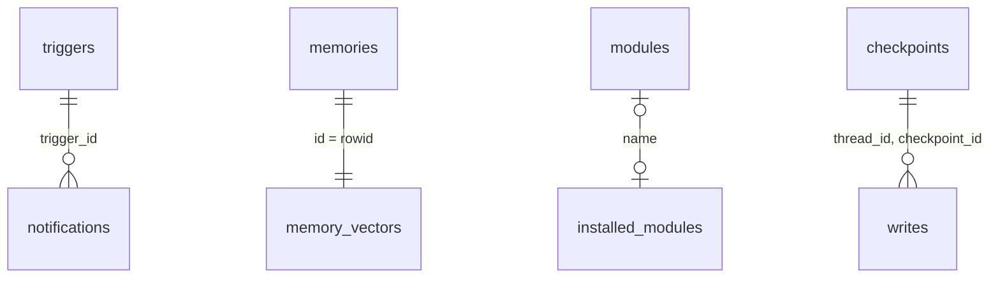

# Data model

One SQLite file holds every table: harness data from `src/migrations.ts`, the `memory_vectors` virtual table created by `src/memories.ts`, and the LangGraph checkpoint tables created by the checkpointer.



There are no foreign key constraints; the links above are logical.

The file holds plaintext module secrets, so `openDatabase` keeps it and its `-wal`/`-shm` files at mode `0600` (owner only) on POSIX systems. On Windows the file inherits the ACL of its directory.

## Migrations

`migrate(db)` reads `PRAGMA user_version`, runs every migration after it in one transaction and bumps `user_version` after each. `openDatabase` calls it on every open.

| Version | Changes                                                                                                                                                 |
| ------- | ------------------------------------------------------------------------------------------------------------------------------------------------------- |
| 1       | Creates `modules`, `triggers` and `memories`.                                                                                                           |
| 2       | Adds `memories.kind` (default `fact`, `CHECK` in `profile`, `fact`).                                                                                    |
| 3       | Rebuilds `triggers` with `AUTOINCREMENT`; creates `notifications` and `pending_extractions`; deletes `stdio` modules (only HTTP modules are supported). |
| 4       | Creates `notification_cursors`.                                                                                                                         |
| 5       | Creates `installed_modules`.                                                                                                                            |

Rule: only append new entries to the `migrations` array. Never edit, remove or reorder an existing one; databases on disk have already applied it.

## Tables

### modules

MCP modules Neo connects to.

| Column       | Type | Notes                                                               |
| ------------ | ---- | ------------------------------------------------------------------- |
| `name`       | TEXT | Primary key.                                                        |
| `config`     | TEXT | JSON `ModuleRegistration` (`name`, `transport: "http"`, `url`).     |
| `created_at` | TEXT | Default `CURRENT_TIMESTAMP`. `listModules` orders by it, then name. |

### installed_modules

Modules managed by the installer as Docker containers.

| Column         | Type | Notes                                                                 |
| -------------- | ---- | --------------------------------------------------------------------- |
| `name`         | TEXT | Primary key; the manifest `id`.                                       |
| `manifest`     | TEXT | JSON `ModuleManifest`.                                                |
| `state`        | TEXT | `installing`, `running`, `stopped`, `failed` or `removing` (`CHECK`). |
| `error`        | TEXT | Last failure, nullable. `saveInstallation` clears it.                 |
| `volume`       | TEXT | Docker volume name.                                                   |
| `container`    | TEXT | Docker container name.                                                |
| `config`       | TEXT | JSON `ModuleConfigValues`, default `{}`. Secrets are stored in clear. |
| `installed_at` | TEXT | Default `CURRENT_TIMESTAMP`.                                          |
| `updated_at`   | TEXT | Set on every save or state change.                                    |

### triggers

| Column       | Type    | Notes                                                      |
| ------------ | ------- | ---------------------------------------------------------- |
| `id`         | INTEGER | `PRIMARY KEY AUTOINCREMENT`: deleted ids are never reused. |
| `definition` | TEXT    | JSON `TriggerDefinition` (`once`, `cron` or `event`).      |
| `created_at` | TEXT    | Default `CURRENT_TIMESTAMP`.                               |

### notifications

| Column         | Type    | Notes                                |
| -------------- | ------- | ------------------------------------ |
| `id`           | INTEGER | `PRIMARY KEY AUTOINCREMENT`.         |
| `trigger_id`   | INTEGER | Trigger that produced it.            |
| `thread_id`    | TEXT    | Proactive thread with the full run.  |
| `content`      | TEXT    | Neo's reply.                         |
| `created_at`   | TEXT    | Default `CURRENT_TIMESTAMP`.         |
| `delivered_at` | TEXT    | Null until a client acknowledges it. |

`deleteDeliveredNotifications(db, before)` removes rows delivered before a date; undelivered rows are never deleted.

### notification_cursors

| Column    | Type    | Notes                                         |
| --------- | ------- | --------------------------------------------- |
| `client`  | TEXT    | Primary key; client id from the events query. |
| `last_id` | INTEGER | Last notification id acknowledged by it.      |

`notificationCursor` inserts the cursor on first use with the id before the oldest undelivered notification (or the newest id, or `0`). `advanceNotificationCursor` only moves it forward.

### pending_extractions

| Column       | Type    | Notes                              |
| ------------ | ------- | ---------------------------------- |
| `id`         | INTEGER | Primary key.                       |
| `transcript` | TEXT    | Exchange to extract memories from. |
| `attempts`   | INTEGER | Failed attempts, default `0`.      |
| `created_at` | TEXT    | Default `CURRENT_TIMESTAMP`.       |

`listPendingExtractions` returns only rows with fewer than 3 attempts.

### memories

| Column       | Type    | Notes                                 |
| ------------ | ------- | ------------------------------------- |
| `id`         | INTEGER | Primary key.                          |
| `content`    | TEXT    | Third-person sentence about the user. |
| `created_at` | TEXT    | Default `CURRENT_TIMESTAMP`.          |
| `kind`       | TEXT    | `profile` or `fact`, default `fact`.  |

### memory_vectors

A `sqlite-vec` virtual table, not created by a migration:

```sql
CREATE VIRTUAL TABLE memory_vectors USING vec0(embedding float[N] distance_metric=cosine)
```

- Created on the first `insertMemory` or `updateMemory`, with `N` = length of that embedding. `rowid` is the memory id.
- An embedding with a different length throws: changing the embedding model requires re-embedding memories.
- `searchMemories(db, embedding, limit)` runs a KNN `MATCH` and returns memories with their cosine `distance`, nearest first; it returns `[]` if the table does not exist yet.
- Inserts, updates and deletes touch `memories` and `memory_vectors` in one transaction.

### checkpoints and writes

Created by `SqliteSaver` from `@langchain/langgraph-checkpoint-sqlite` (`createCheckpointer(db)`) on first use, not by the migrations. They store LangGraph state per `thread_id` and `checkpoint_ns`.

`listThreadIds(db, prefix)` returns the distinct `thread_id` values starting with `prefix`, or `[]` when the `checkpoints` table does not exist yet. Core uses it to tell user threads from `proactive:` threads.

## Testing

`src/storage.test.ts` opens `":memory:"` databases and covers migrations, legacy data upgrades, vector search, trigger id reuse, notifications and cursors, extraction retries, thread listing and installations.
